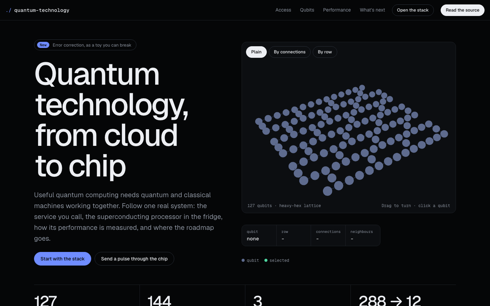

# Quantum Technology

> An interactive explainer of how quantum computers are reached, built, measured and improved, with a 3D 127-qubit heavy-hex lattice, eleven figures, a performance lab, an error-correction toy and a roadmap.



Built by [Anas Aslam](https://github.com/4pfanas) as a portfolio piece. A single `index.html` with no build step.

## What is in it

| Section (`id`) | Content |
| --- | --- |
| Hero (`top`) | A 3D **127-qubit heavy-hex lattice**. Drag to turn it, click a qubit to see its row, connections and neighbours. Three colour modes: Plain, By connections, By row. A "send a pulse" button animates a signal through the chip |
| Quantum and classical, side by side (`questions`) | Why both are needed, what exists, and how good a machine is |
| How you reach a quantum computer (`stack`) | **Fig 1** the access stack pulled apart (platform, middleware, runtime, processor) with a "send a job" animation and clickable layers. **Fig 2** the GPU comparison. **Fig 3** what each layer does |
| What the qubits are made of (`qubits`) | **Fig 4** qubit technologies drawn side by side (transmon). **Fig 5** superconducting vs photonic vs trapped-ion comparison |
| Power is more than qubit count (`performance`) | Scale, quality and speed; Quantum Volume, CLOPS and EPLG; **Fig 6 performance lab**; a true/false check |
| Useful today, fault tolerant tomorrow (`next`) | **Fig 7** the utility experiment. **Fig 8** error-correction toy. **Fig 9** roadmap by lane. **Fig 10** size of each milestone on a log scale. **Fig 11** quantum-centric supercomputing |
| Glossary and "What to remember" | Short definitions and a summary |

## Interactive pieces

- **Lattice** (`three.js`): 127 qubits and 144 couplings on a heavy-hex layout. Select a qubit to read its row and neighbours.
- **Access stack**: press *Send a job* and watch it travel down the layers and back, or click a layer to read what it does.
- **Performance lab (Fig 6)**: three sliders (qubits used 1–127, error per gate, circuits per second) with presets (*Many qubits, noisy*, *Few qubits, clean*, *Balanced*). It reports gates per circuit, chance of an error-free run and error-free runs per second.
  The toy model is `chance of no error = (1 − error)^gates`, with `gates = qubits × 10`. Quality stands in for IBM's QuOps. Real systems are more complicated.
- **Error-correction toy (Fig 8)**: a grid of logical qubits, each made of 12 data and 12 check qubits. Set the error rate per qubit per cycle, run 50 cycles, and switch error checks on or off. A row fails when more than 3 of its qubits go wrong at once. It illustrates the idea behind IBM's Gross code (about 288 qubits protecting 12 logical qubits) and does not run the real code.
- **Roadmap (Fig 9)**: click an event to see it. Fig 10 draws qubits, gates and logical qubits on a log scale.
- **True or false** quiz on whether qubit count alone sets a machine's power.

## Accuracy notes

- Content is paraphrased. Dates, targets and figures are IBM's own claims, not forecasts by this page.
- The utility-experiment curves in Fig 7 are a schematic of the course's description, not measured data.
- The performance lab and the error-correction toy are simplified teaching models.
- Experts often expect practical fault-tolerant machines to need millions of physical qubits. The page says so alongside the Gross-code figures.

## Source and credit

Content is paraphrased from:

- IBM Quantum Learning, ["IBM Quantum technology"](https://quantum.cloud.ibm.com/learning/en/courses/quantum-business-foundations/quantum-technology) (course page).
- IBM Think, ["What is quantum computing?"](https://www.ibm.com/think/topics/quantum-computing).

Independent project, not affiliated with IBM.

## Tech

- Plain HTML, CSS and JavaScript; SVG for the figures.
- [three.js](https://threejs.org/) r128 from cdnjs for the lattice.
- Google Fonts: Geist and Geist Mono.
- Respects `prefers-reduced-motion`.

## Run it

Open `index.html` in a browser, or serve the folder:

```bash
npx serve .
# or
python3 -m http.server 8000
```

It needs internet for three.js (cdnjs) and the Geist fonts (Google Fonts). It still works without the fonts.

## Deploy

Drag the folder into Vercel, or from the folder run `vercel --prod`. Any static host works.

## Project structure

```
index.html        the whole site: markup, styles, SVG figures and scripts
docs/screenshots  images used in this README
```

## Licence

Site design and code: Anas Aslam. No licence has been chosen yet, so all rights are reserved.
